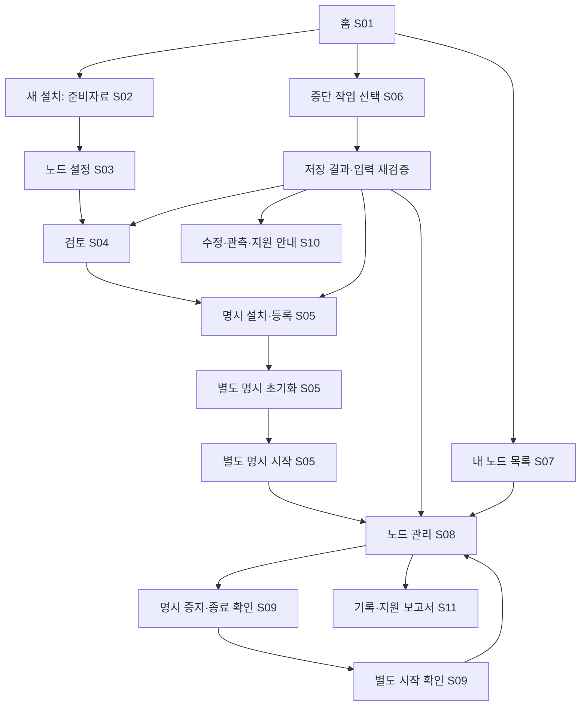

# 통합 설치·운용 UX 설계안

> 최신 결정(2026-10-22): **console 개발 중단·직접 CLI 우선**. 아래 console 통합 설계/화면은 기존 구현과 시안의 참고 기록으로 보존한다. 후속 구현 순서와 완료 조건은 [CLI 우선 설계](./2026-10-22-cli-simplification.md)와 [현재 구현 계획](./2026-10-22-integrated-operations-ux-implementation-plan.md)이 대체한다. console 화면 추가나 서비스 연결을 현재 작업 범위로 해석하지 않는다.

- 작성일: 2026-10-22
- 상태: **전체 UX 설계안. UX-01~03의 공통 문답·console 홈/목록/기존 자료 읽기와 이름 기반 설치 자료 준비는 구현했으며, 통합 설치·반복 운용·새 패키지 인수·처음 사용자 과업은 후속**이다. 현행 기능은 [console 가이드](../docs/console.md)를 따른다.
- 기준: BXDL `870ca725d2a57e25b0fb0b574766d19e7600a733`(PR #15 병합), RC.3/선정 Temurin의 기존 인수 기록.
- 사용자 요청: 설치·운용의 직관성을 먼저 개선하며 Rust·macOS arm64·수동 LaunchAgent를 유지한다.
- 연결: [직접 CLI 간소화](./2026-10-22-cli-simplification.md), [화면 명세](./2026-10-22-integrated-operations-ux-screens.md), [구현 계획](./2026-10-22-integrated-operations-ux-implementation-plan.md), [클릭 가능한 시안](./prototypes/integrated-operations-ux.html).

## 1. 목표와 현재 문제

NIGO 내부를 모르는 설치 담당자가 승인 자료를 받아 새 노드를 설치하고, 다음 날 경로를 기억하지 않아도 같은 노드를 찾아 운용하게 한다. 운영자가 노드와 원하는 행동을 선택하면 제품이 준비자료·상태·허용 조건을 확인한다. 간단한 작업은 직접 CLI 한 줄로 수행하고, 설치처럼 안내가 필요한 작업은 문답이나 console에서 진행한다. 두 진입점은 같은 내부 작업과 검증을 사용한다.

기존 [RC.3 설치 UX 21사례](../results/2026-10-22-macos-rc3-full-setup.md)는 준비한 입력과 절차의 실행 정확성을 검증했다. 초보 사용자의 발견 가능성·이해도·오류 해결 능력을 검증한 결과는 아니다. 이 설계의 시안과 목표도 실제 PASS로 표시하지 않는다.

| 현재 근거 | 사용자에게 생기는 문제 | 설계 대응 |
| --- | --- | --- |
| [설치 준비](../src/setup/install_wizard.rs)는 native를 먼저 요구하고 [network](../src/setup/network.rs)는 제품 설정을 요구 | 세 도우미와 JSON 전달 순서를 알아야 함. `--from`으로 재입력은 피할 수 있으나 사용자가 연결해야 함 | 하나의 여정에서 제품 초안·network·설치의 전달을 연결 |
| 설치용 workspace·package·control·data의 부모를 사전 준비 | 내부 저장 구조를 먼저 알아야 함 | 검증하는 기본 관리 루트와 고급 경로 설정 |
| 설치 `edit`는 첫 질문부터, 일부 preflight 오류는 포괄적 메시지 | 잘못된 항목을 찾고 수정하기 어려움 | 항목별 검토·수정, 실패 항목과 다음 행동 연결 |
| 매번 긴 `--instance` 경로와 설치 자료를 반복 지정 | 같은 노드의 경로·중간 파일을 계속 기억해야 함 | 명시 고유 별칭으로 운용, 명명된 준비 세션의 `setup new/resume`으로 답 재사용 |
| 설치 메뉴에 stop/logs/diagnose 없음 | 설치 후 별도 명령·경로를 기억해야 함 | 내 노드 목록과 반복 운용 화면 |
| 상태 코드·여러 상태 축을 동시에 표시 | 실행 중인지, 지금 무엇을 해야 하는지 해석 필요 | 과업 상태 요약 → 권장 행동 → 상세 근거 순서 |
| 하위 `--help` 미지원, 공급 입력의 `:help`가 경로로 처리됨 | 같은 도구 안에서 조작이 일관되지 않음 | 공통 입력 규칙과 명령별 도움말 |
| 현재 가이드에 RC.1/RC.2 및 V2 이전 설명 잔존 | 보존할 파일·현재 지원 범위가 혼동됨 | 현재 가이드와 역사 기록을 분리 |

## 2. 사용자와 책임

| 역할 | 준비·결정하는 것 | 통합 UX에서 하는 일 |
| --- | --- | --- |
| 패키지 공급 담당자 | 선정 CLI/JAR/JRE package, engine lock, 독립 경로의 신뢰키·확인 정보 | 제작자용 기존 명령 사용. 운영자 홈의 주 메뉴에서는 분리 |
| 네트워크 관리자 | 승인 chain, 공개 validator/peer/pin 목록, 참여 방식·권한, 발급된 자격 자료 | 설치 담당자에게 승인 자료와 자기 노드 식별 정보를 전달 |
| 설치·운영 담당자 | 자기 노드 선택, 로컬 자료 위치·저장 공간·포트 검토 | 설치·초기화·시작 승인, 재개, 상태·중지·재시작·진단 |

첫 범위는 validator/RocksDB다. 고객 PKI 발급, 새 chain/membership 생성, 기존 네트워크의 가입 승인 자체는 제공하지 않는다. `new-network`는 승인된 새 네트워크의 구성 선택이며 네트워크 생성/승인 자동화가 아니다. `join-network` 입력 성공은 catch-up 성공이 아니다.

## 3. 진입점과 호환성

```text
bxdl console
bxdl console --home <관리-루트>
bxdl console --instance <기존-control-경로>
```

위 명령은 **UX-02의 홈·목록·기존 등록/세션 읽기와 UX-03의 공유 설치 자료 준비를 구현**했다. 이후 절의 통합 설치·실행 동작은 후속 계획이다. `console`은 대화형 터미널 전용이며 비TTY·`--json` 조합은 쓰기 전에 설명과 usage 오류로 종료한다. `--instance`는 지원되는 기존 등록을 명시적으로 여는 경로이며 재등록·DB 채택·migration이 아니다. `--home`과 함께 쓸 수 있지만 목록 저장은 별도 선택이다.

- 인자 없는 `bxdl`, `help`, 기존 `setup` 세 모드, 개별 명령과 JSON/exit 계약은 유지한다. 도움말 본문에는 새 사용자용 빠른 시작을 먼저 배치한다.
- `setup`을 갑자기 설치 명령으로 바꾸지 않는다. 기존 자동화는 기존 명령을 계속 사용한다.
- 콘솔 종료 0은 화면을 정상 종료했다는 뜻이다. 취소/EOF는 5, 사용법 오류는 2, 저장/출력 오류는 기존 오류 체계를 따른다. 노드 정상 여부는 별도 화면 결과다.
- 내부 API와 정책을 재사용한다. 셸 문자열 조합이나 카탈로그의 임의 프로그램 실행으로 기존 CLI를 연결하지 않는다.
- 기존 Draft/Network/Workflow·binding V1/V2 저장 형식을 자동 변환하지 않는다. 기존 세션은 명시 경로 연결과 지원 버전의 기존 재개 API로 연다.



분기 화살표는 조건부 선택이다. 재개가 모든 단계를 자동 실행하는 의미가 아니다.

### 3.1 직접 CLI 간소화

[CLI 간소화 설계](./2026-10-22-cli-simplification.md)를 함께 적용한다. UX-03은 `bxdl setup new <name> [--home <root>] [--from <instance.json>]`과 `bxdl setup resume <name> [--home <root>]`를 console과 같은 준비 API로 연결하는 단계다. 새 준비 기록은 기존 setup/workflow와 구분하며 실제 설치·init·start 연결은 UX-04다. 이름은 `^[a-z][a-z0-9-]{0,31}$`를 따르고 같은 관리 루트에서 중복 생성하지 않는다.

UX-05에서는 `bxdl nodes`, `bxdl status/start/stop/logs <alias>`를 추가하고, UX-06은 `bxdl diagnose <alias> --output ...`, UX-07은 도움말 구조와 셸 자동완성을 완성한다. 현재 구현 여부는 각 단계와 가이드를 따른다. 별칭과 기존 `--instance` 경로를 동시에 지정하지 않으며, 대상 생략 시 마지막 사용 노드를 추정하지 않는다.

표시명은 중복을 허용하고, 기존 opaque `entryId`는 불변이며, 명령용 별칭은 명시 지정·변경하는 고유 이름이다. 준비 세션명과 노드 별칭은 별도 namespace다. 기존 표시명·engine ID를 별칭으로 자동 채택하지 않는다. 별칭 해석 뒤에도 현재 root/binding·CLI·입력·실행 시도를 다시 검증한다.

## 4. 준비자료와 설치 여정

### 4.1 자료 선택

자료를 세 그룹으로 보여준다. 처음부터 14개 문답을 시작하지 않고 무엇이 있고 무엇이 부족한지 먼저 확인한다.

1. **제품 공급 자료:** package archive, engine lock, package 밖에서 신뢰한 공개키. 서명 없는 개발 후보 선택은 고급 개발 모드에서 명시한다.
2. **승인된 네트워크 자료:** chain과 기존 공개 network JSON, 또는 준비된 제품/native 조합. 자기 노드는 공개 목록에서 선택하며 일치 여부를 검사한다.
3. **이 노드의 자격 자료:** NGVK·TLS key/trust store·비밀번호 파일의 기존 참조. 내용은 화면·카탈로그·지원 결과에 출력하지 않는다.

첫 구현은 기존 파일 계약을 재사용한다. 새 공급 bundle/descriptor 형식이나 자체 신뢰 체계를 만들지 않는다. 폴더 선택을 제공하더라도 제한된 후보 목록만 보여주고 자료별 역할과 선택을 확인한다. 같은 폴더에 들어 있는 공개키라는 이유로 신뢰하지 않으며 trust root 확인은 독립적이다.

부족한 자료는 `미제공 / 읽기 실패 / 형식 오류 / 불일치 / 확인 완료`로 구분하고 요청할 담당 역할을 표시한다. 초안 저장은 가능하지만 필요한 검사 전 설치·초기화·시작은 활성화하지 않는다. 파일 존재 검사는 자격 자료의 암호학적 유효성 확인과 구분한다.

### 4.2 설정과 수정

- 이름, 선택 노드, HTTP/P2P, 자료 상태, 새 저장 위치, 네트워크 참여 방식, archive 정책을 한 검토표에 표시한다.
- 승인 자료에서 확인 가능한 ID/peer/pin은 가져오고 로컬 설정과 대조한다. 임의 추론·키 발급·chain 보정은 하지 않는다.
- 기존 제품 JSON이 있으면 가져오며, 새 제품 JSON은 기존 필드 검증으로 만든다. 운영자는 중간 JSON 출력 경로를 다시 입력하지 않는다.
- 공개 설정은 저장값을 보여주고 항목 번호로 바로 수정한다. 자격 자료는 역할·선택 여부·검사 결과를 기본 표시하며 원문 비밀번호는 받지 않는다.
- 공개 network를 바탕으로 native를 만드는 경로와 이미 준비된 native를 사용하는 경로를 지원한다. 후자는 제품/native 일치 검사가 필수이며 자동 덮어쓰지 않는다.
- 설정을 수정하면 영향받은 제품/native/계획을 무효화한다. 원래 pin을 덮어쓰지 않고 새 revision·새 출력 경로로 준비해 변경 전후를 확인한다. 설치 출력 생성 뒤의 설정·키 변경은 이번 범위 밖이다.

### 4.3 확인과 실행

| 단계 | 확인 화면 | 완료 판단 |
| --- | --- | --- |
| 계획 | 대상 노드·engine/runtime 식별, 주소·포트·체인 정책, 생성 경로·보존 자료·알려진 공간 요구 | 고정한 입력과 새 출력 검증. DB/서비스 미실행 |
| 설치·등록 | 새 파일·package·등록 생성 범위, 아직 DB 초기화/시작하지 않음 | 기존 installer·등록 API의 소유 결과·신뢰 검증 |
| 초기화 | 새 DB 대상·chain/genesis·자산 등록 정책, 이후 임의 변경 불가 | 기존 init의 종료·journal/report·identity 검사 |
| 시작 | 선택 노드와 사용자 LaunchAgent, 로그아웃 시 종료·자동 재시작 없음 | 요청 수락과 로컬 READY 관측을 구분 |

각 변경 작업은 별도로 확인하며 기본 응답은 실행하지 않음이다. 정상적인 초안 저장·중간 종료는 오류가 아니다. cold의 알려진 `INCOMPLETE`는 “실행 전 검사 완료, 실행 검사는 아직 안 함”으로 설명할 수 있지만 원 결과와 미검사 범위는 상세에 유지한다.

## 5. 관리 루트·목록·자료 수명

기본 후보는 `$HOME/Library/Application Support/BXDL`이다. 이 경로가 모든 Mac 보호 정책에서 검증됐다는 의미는 아니다. 실제 서비스 관점 접근 인수를 별도로 한다.

```text
<home>/                         # 0700, 신규 준비 또는 검증한 기존 BXDL 루트
  catalog/                      # 탐색용 목록, 파일 0600
  sessions/<name>/               # 명명된 새 준비 조정 기록 + 필요한 하위 세션
  configs/<operation-id>/        # 새 제품 원본/native 등; 기존 export workspace와 분리
  packages/<installation-id>/    # 새 설치본; 첫 범위에서는 공유/중복 제거 안 함
  instances/<entry-id>/          # 기존 instance control
  data/<entry-id>/               # 새 데이터
  reports/                      # 명시 생성하는 새 정제 지원 보고서
```

각 실제 workflow workspace, package, control, data는 서로 포함되지 않는다. native 출력도 network workspace 밖이다. 상위 관리 폴더 준비는 소유/권한/link 검사를 통과한 뒤 필요한 디렉터리만 생성한다. 기존 폴더의 자동 chmod·덮어쓰기·불완전 root 채택은 하지 않는다. 홈 화면을 열거나 목록을 조회한 것만으로 폴더를 생성하지 않는다.

**완료된 설치 세션은 영구 운용 자료다.** 현재 제품 설정은 install workflow의 `generated/`에 있고 binding에 고정된다. 따라서 위 `configs/`가 모든 운용 설정을 대체하지 않는다. 설치 기록 삭제·이동·자동 정리는 제공하지 않는다. 별도 설정 저장소로 옮기는 일은 명시 migration 설계가 필요하다.

| 자료 | 새 V2 등록 후 정책 |
| --- | --- |
| archive·신뢰 공개키·engine lock | 기존 `control/trust/` 검증 사본 사용. 등록 전 원본 보존; 등록 불명 시 삭제 안내 금지 |
| 제품 설정·native·chain·키/비밀번호 참조 | 계속 필요. 초기 버전은 명시 참조를 유지하며 자동 이동/복사/재핀하지 않음 |
| package·control·data·설치 session | 운용 자료로 계속 보존 |
| 기존 V1 | 원본 공급 자료도 계속 필요. 목록 연결로 V2 변환되지 않음 |

카탈로그는 `entryId`, 종류(instance/session), 표시명, 정규 경로, 확인한 root identity·schema, 마지막 관측 시각·요약을 갖는 별도 버전형 private 색인이다. 명령용 고유 별칭은 UX-05에서 명시 지정과 버전형 저장 계약으로 추가하며, UX-03이 기존 목록 형식을 선제 변경하지 않는다. 표시명이나 instanceId는 전역 유일키가 아니다. 원문 credential, key hash, 건강 상태의 권위 있는 판정은 저장하지 않는다.

- 첫 범위는 콘솔이 만든 항목과 사용자가 **명시 경로로 연결한 항목**만 다룬다. 전체 홈/디스크 재귀 검색이나 외부 자료 자동 편입은 하지 않는다.
- 선택 시와 변경 직전에 기존 root/binding/입력 검사를 다시 한다. 목록의 READY·경로·CLI 정보만 믿고 실행하지 않는다.
- 카탈로그 원자 갱신·잠금·상한·손상 검사를 둔다. 읽을 수 없으면 명시 경로 열기와 기존 CLI는 사용할 수 있다. 손상 색인을 자동 초기화하지 않는다.
- 설치/등록 성공 뒤 목록 갱신 실패는 “작업 완료, 목록 기록 실패”다. 이를 설치 실패로 바꿔 재실행시키지 않는다. 복구에 필요한 명시 경로를 안내한다.
- “목록에서 숨기기”는 색인만 변경한다. 중지·제거·DB 삭제 기능이 아니다. 새 노드 생성 화면에 재사용 가능한 기존 DB로 나타내지 않는다.

## 6. 반복 운용과 CLI 선택

운용 controller는 기존 `instance::service` API를 사용한다. 설치 journal의 `start`는 최초 설치의 이력이다. 정상 stop 뒤 이를 `Pending`으로 되돌려 재시작하지 않으며, 반복 실행 상태는 별도로 조회한다.

- 시작·중지·상태 재조회·같은 시도 대기·최근 기록·정제 보고서를 노드 화면에 모은다.
- 재시작은 **정상 중지 확인 → 별도 시작 확인**이다. 중지 불명·관측 만료·CLI 종료 시 후속 시작을 예약하지 않는다. 이미 시작 요청을 보냈다면 화면 대기 취소가 서비스 중지를 뜻하지 않는다.
- 기존 잠금, exact artifact/입력 검사, 일회 start gate, 정상 `StoppedVerified` 조건을 모두 재사용한다. UI의 가능 버튼은 편의 표시이며 권한/실행 판정은 API가 다시 한다.
- 다른 콘솔/기존 CLI가 상태를 바꾸면 현재 시도 변경을 표시하고 재확인한다. 최초 화면의 READY나 기존 승인으로 새 시도를 자동 조작하지 않는다.

확인창의 승인은 대상 control root/binding identity와 관측한 attempt(시작 전이면 실행 이력 없음 또는 마지막 정상 종료 attempt)에 결속한다. 현재 `service::stop(instance, timeout)`는 호출 시 최신 attempt를 읽으므로 UI 사전 조회만으로 이 조건을 보장하지 못한다. 필요한 내부 adapter에 expected identity/attempt를 전달하고 의도 게시·신호 전달 대상의 결속을 기존 잠금/기록 규칙 안에서 보장한다. 대상 변경이 확인되면 승인을 폐기하고 재조회한다. 운영자 입력을 기다리며 장기 service 잠금을 잡지 않는다. 기존 개별 CLI의 인자/출력 계약은 유지한다.

**새 console CLI가 기존 RC.3 설치를 그대로 시작할 수 있다고 약속하지 않는다.** 현 start는 현재 CLI와 설치본 CLI 바이트 일치를 요구한다. 지원되는 기존 형식은 읽기·진단으로 연결할 수 있으나, 실행 호환성을 확인하지 못한 변경 작업은 차단한다. 기존 설치본의 검증된 CLI 명령을 안내하며 자동 exec/바이너리 덮어쓰기/upgrade는 하지 않는다. 통합 UX 전체 인수에는 새 console이 들어간 새 BXDL package가 필요하다. NIGO RC.3와 JRE pin을 그대로 사용할 수 있다.

## 7. 상태와 다음 행동

사람용 투영 모델은 기존 JSON DTO/exit와 분리한다. 화면은 노드 이름·대상 구분, 한 줄 요약, 관측 시각, 다음 행동, 상세 순서다. 카탈로그 목록은 저장된 관측이며 선택 전 전체 노드의 긴 status 호출을 자동 수행하지 않는다. 선택 화면의 “새로 확인”과 “준비 상태 기다리기”만 예산 있는 live 조회를 수행한다.

| 관측/근거 | 화면 요약 | 허용하는 다음 행동 |
| --- | --- | --- |
| 초안 또는 필수 자료 부족 | 준비자료 확인 필요 | 해당 항목 수정, 초안 저장 |
| 설치·등록 완료, init 미실행 | 설치 완료 · 초기화 전 | 검토 후 명시 init, 나가기 |
| 초기화 완료, 실행 이력 없음 | 초기화 완료 · 시작 전 | 명시 start |
| 같은 시도의 STARTING | 시작 중 | 같은 시도 대기, 상태·기록 확인 |
| live READY 관측 | 실행 중 · 로컬 준비 완료 | 새로 확인, 명시 stop, 기록/보고서 |
| 관측 기한 만료 | 실행 여부 확인 필요 · 관측 시간 종료 | 같은 시도 재조회, 기록 확인; 실패/종료로 단정하지 않음 |
| STOPPED 관측이나 정상 종료 확정 미게시 | 정지 관측 · 종료 확인 필요 | 명시 stop으로 종료 확인; 새 start 차단 |
| StoppedVerified와 등록 정리 확인 | 정상 종료 확인됨 | 별도 명시 start |
| GUI 세션 부재 | 로그인 세션 확인 필요 | 세션 범위 안내·기록 조회; 자동 LaunchDaemon 전환 없음 |
| 입력 오류·pin 불일치 | 지정 자료 확인 필요 | 설치 전이면 해당 항목 수정·새 계획; 설치 후면 변경 차단·지원 안내 |
| UNKNOWN/보고서 유실/gate 거부로 재시작 차단 | 지원 검토 필요 | 안전한 상태 조회·정제 보고서; 자동 상태 해제 없음 |
| CLI 불일치 | 이 설치를 시작할 CLI 확인 필요 | 지원되는 읽기·검증된 설치 CLI 안내 |

READY는 로컬 준비 상태다. 합의는 기존 근거가 없으면 미확인으로 둔다. 화면을 다시 열었을 때 과거 READY를 현재 상태로 재사용하지 않는다. sleep/wake·세션 단절 뒤 이전 관측도 저장 기록으로 표시한다. `startupStage`는 마지막 진입 기록이며 완료율이나 권한 오류의 확정 원인이 아니다.

지원 검토가 필요한 경우 계속 start/status/stop을 반복하도록 유도하지 않는다. 안전한 읽기와 보고서 생성, 필요한 자료·수동 지원 안내로 끝낸다. 보고서는 자동 전송하지 않는다. 현재 logs/diagnose의 최신 시도·정제·예산·partial 범위를 유지하고 원문 로그 전체를 노출하지 않는다.

## 8. 구현 경계와 검증

| 구분 | 이번 UX 범위 |
| --- | --- |
| 포함 | 직접 CLI의 명명된 준비 세션·명시 노드 별칭, 터미널 통합 여정, 공통 문답, 탐색용 목록, 기본 경로 제안·준비, 설치/운용 controller, 상태·오류 안내, 정제 보고서 연결 |
| 별도 필수 후속 | 안전 제거 REM-01, 실제 mutation 중단·로그아웃·sleep/wake를 포함한 나머지 G1-M 인수 |
| 별도 G2 | A7 offline Storage inspect/repair, 기존 설치 업데이트·V1 migration·DB 호환 버전 쌍 |
| 범위 밖 | 웹 관리 서버, PKI 발급, 고객 네트워크 승인, UNKNOWN 강제 해제, 자동 로그인 시작/재시작, LaunchDaemon, Linux/systemd·Docker 구현 |

공통 화면·controller·상태 모델은 플랫폼 adapter와 분리한다. 첫 기능 활성화는 검증한 Mac profile에 한정하며 Linux/Docker에서 미지원 버튼을 실행시키지 않는다.

NIGO의 현재 engine-info/cold/init/resume/run/runtime 계약으로 초기 UX를 진행할 수 있다. 새 NIGO 구현 요청을 선행 조건으로 만들지 않는다. 새 계약이 실제로 필요한 결함은 재현 근거로 별도 제안한다. 고객 배포 조건·J5·최소 OS·전체 제품 인수는 UX 완료와 별개다.

검증은 세 층으로 나눈다: (1) 상태/문답/호환 회귀, (2) 새 exact package 실제 PTY·서비스 인수, (3) 작성자가 아닌 사람의 다섯 과업. 첫 사용자 과업은 새 설치, 파일 하나 수정, 중단 후 재개, 다음 날 정상 중지·재시작, 지연/실패 후 지원 자료 생성이다. 세부 성공 기준은 [구현 계획](./2026-10-22-integrated-operations-ux-implementation-plan.md)을 따른다.
